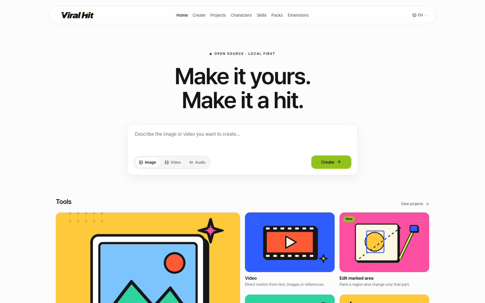
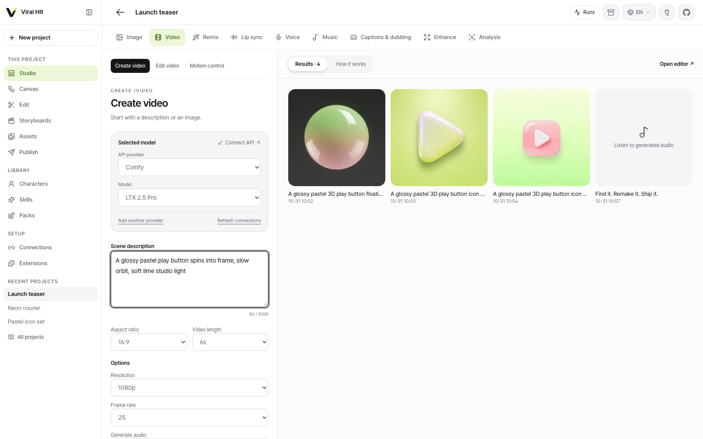
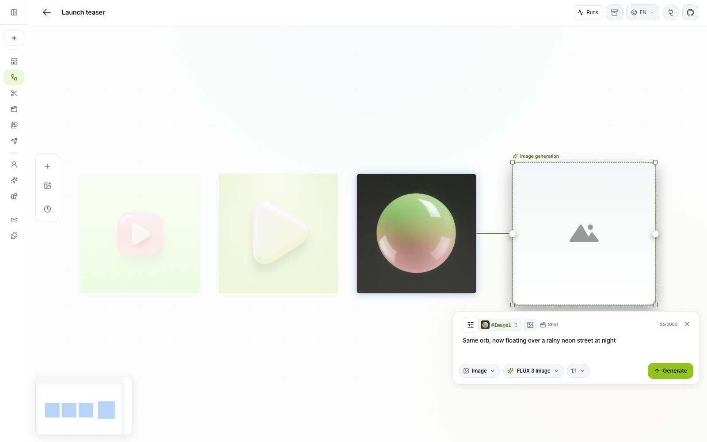
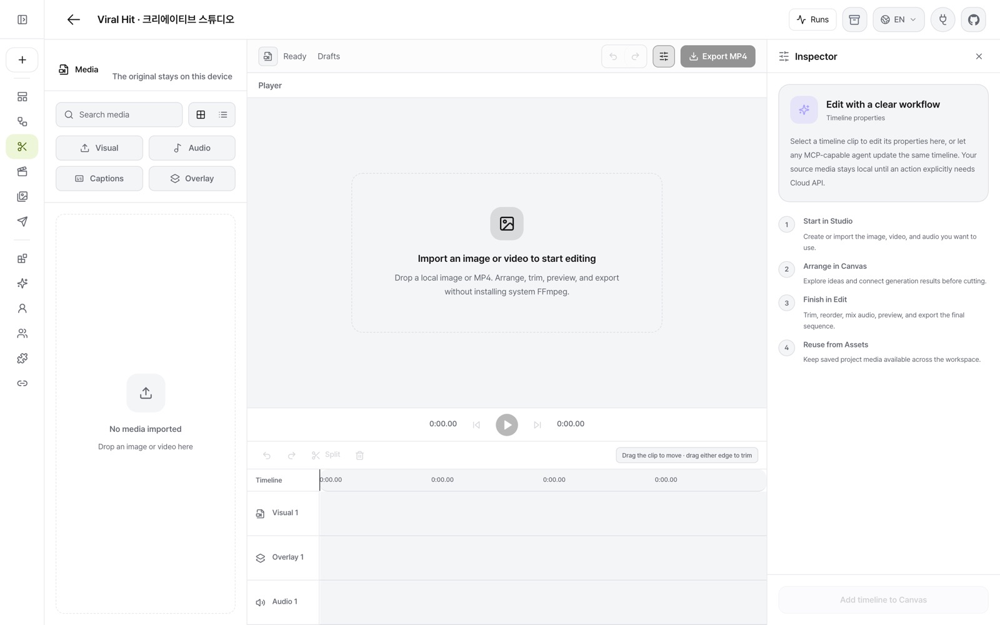
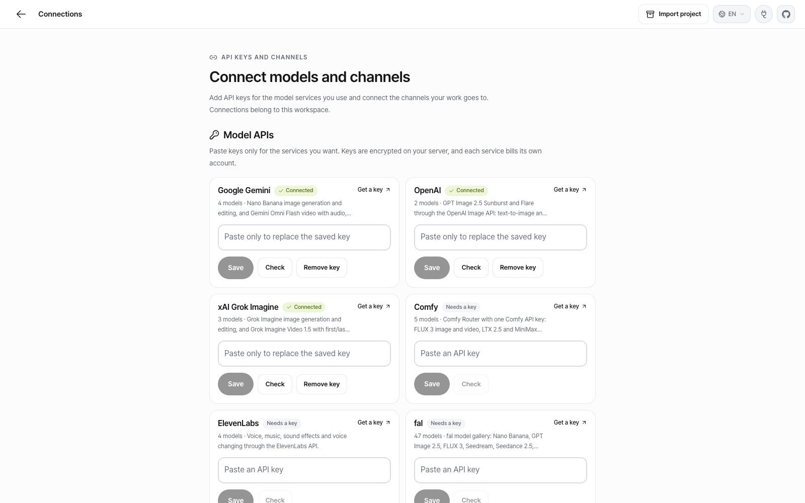
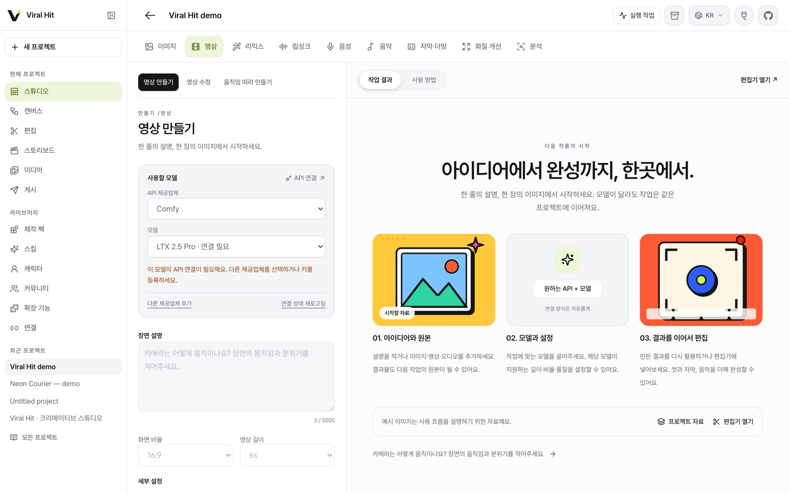
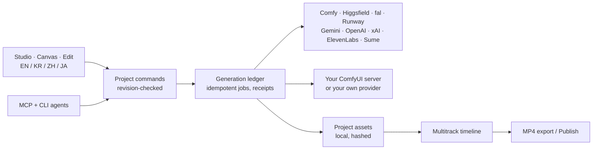

<p align="center">
  
</p>

<h2 align="center">Higgsfield + CapCut, open source.</h2>

<h3 align="center">Find a hit. Remake it with any model. Cut it. Ship it. Measure it. One open-source app, one project you own.</h3>

<p align="center">
  <a href="LICENSE"></a>
  
  
  
</p>

<p align="center">
  <a href="#run-it-in-two-minutes"><b>Run it</b></a> ·
  <a href="#the-viral-loop"><b>The viral loop</b></a> ·
  <a href="#why-viral-hit"><b>Why Viral Hit</b></a> ·
  <a href="#what-you-get"><b>What you get</b></a> ·
  <a href="#models-and-apis"><b>Models and APIs</b></a> ·
  <a href="#how-it-fits-together"><b>Architecture</b></a> ·
  <a href="#extend-it"><b>Extend it</b></a>
</p>

---

Higgsfield promised to open-source its platform. **Viral Hit is our open answer, built around how a viral video actually gets made**: Higgsfield-style generation and a CapCut-style editor in the same app, plus the steps before and after them, from studying a reference to publishing and reading the numbers. Image, video, audio, editing and an agent harness share one project. Results land as real files in your project, go straight onto a multitrack timeline, and export as MP4. No lock-in to one model vendor: connect Comfy Router, Higgsfield, fal, Runway, Gemini, OpenAI, xAI, ElevenLabs, Sume, your own ComfyUI server, or a model you wrote yourself.

**▶ [Watch the 1-minute demo](docs/readme/demo.mp4)** — Comfy, Higgsfield and Sume models in one Studio, the multitrack editor, publishing, storyboards and the Korean interface.

<p align="center">
  
</p>

## The viral loop

| Step | What happens in Viral Hit | Docs |
|---|---|---|
| **1. Find** | Import a reference from a file, a YouTube link (optional intake extension) or a video shared to your Instagram inbox. Viral Hit keeps the original, samples frames and splits it at visual cuts. | [Reference intake](docs/REFERENCE-INTAKE.md), [scene detection](docs/SCENE-DETECTION.md) |
| **2. Break it down** | Turn the reference into a storyboard: shots, timing, camera, characters. An analysis model can draft it; you edit every line. | [Storyboards](docs/STORYBOARDS.md), [structured analysis](docs/STRUCTURED-ANALYSIS.md) |
| **3. Remake** | Produce each shot with FLUX 3, LTX 2.5, MiniMax H3, Higgsfield, Sume or your own ComfyUI. Keep characters consistent and accept the best take per shot. | [Characters](docs/CHARACTERS.md), [shot controls](docs/SHOT-CONTROLS.md) |
| **4. Cut** | Accepted shots land on a multitrack timeline with voice, music and captions. Trim, layer, swap takes and export MP4. | [Editable sequences](docs/EDITABLE-SEQUENCES.md) |
| **5. Ship** | Publish to YouTube or Instagram, or any destination you install, with approval, scheduling and receipts. | [Publishing](docs/PUBLISHING.md) |
| **6. Measure** | Record views and engagement for each published version, then start the next remake from what worked. | [Measurement](docs/MEASUREMENT.md) |

An AI agent can run the same loop end to end through MCP or the CLI.

## Why Viral Hit

The #OpenSourceHiggsfield challenge produced close to a hundred projects. Most recreate one effect, and about two dozen are studios that generate clips. Viral Hit covers the whole job, from the reference you want to beat to the numbers after you post.

| | One-effect apps | Generation studios | **Viral Hit** |
|---|:---:|:---:|:---:|
| Generate images and video | One effect | ✅ | ✅ 9 tools, 9 services, any model you add |
| Remix: motion transfer, subject swap, restyle | Often one | Some | ✅ |
| Lip sync, voice, music, captions, dubbing | — | Some | ✅ |
| Import a reference and split it into shots | — | Rare | ✅ |
| Storyboards with one accepted take per shot | — | Rare | ✅ |
| Multitrack timeline with MP4 export | — | Rare | ✅ visuals, overlays, audio, captions |
| Publish to YouTube and Instagram | — | — | ✅ with approval, scheduling and receipts |
| Track how each published version performs | — | — | ✅ |
| Paid jobs survive crashes without double charges | — | — | ✅ |
| Agents run every step (MCP and CLI) | Rare | Some | ✅ |
| Add a model without changing the app | — | Some | ✅ installed provider folders |
| English and Korean interface | — | — | ✅ plus Chinese and Japanese |

## What you get

<table>
  <tr>
    <td width="50%"></td>
    <td width="50%"></td>
  </tr>
  <tr>
    <td><b>Studio.</b> Nine creation tools: image, video, remix (motion transfer, subject swap, restyle), lip sync, voice, music, captions and dubbing, enhance and analysis. Choose the task, then any provider and model that supports it.</td>
    <td><b>Canvas.</b> Lay out ideas, prompts and generations on an infinite board, branch versions, and send the winners to the edit.</td>
  </tr>
  <tr>
    <td></td>
    <td></td>
  </tr>
  <tr>
    <td><b>Edit.</b> A real multitrack timeline: visuals, overlays, audio and captions, reversible takes, recovered drafts and MP4 export in the browser or on the server.</td>
    <td><b>Connections.</b> Paste a key once. Keys stay encrypted on your server, are never sent to the browser, and each job remembers the key it started with.</td>
  </tr>
</table>

| Higgsfield-style app | In Viral Hit |
|---|---|
| Image and video generation | **Studio → Image / Video** with any connected provider |
| Cinema Studio (direct the shot) | [Shot controls](docs/SHOT-CONTROLS.md) for framing, lens, camera move, light and look, plus [storyboards](docs/STORYBOARDS.md) that plan, produce and accept each shot |
| Genjutsu / Openjutsu (swap a character in a video) | **Studio → Remix** with motion transfer, subject swap and restyle |
| Consistent characters | [Characters](docs/CHARACTERS.md): reference images and written rules reused in every project |
| Lip sync, voice, music | **Studio → Lip sync / Voice / Music** |
| Publishing | [Publish](docs/PUBLISHING.md) to YouTube, Instagram or your own installed destination, with [performance readings](docs/MEASUREMENT.md) |
| Agents | Every action is also an [MCP tool and CLI command](docs/ARCHITECTURE.md), so an AI agent can run the studio too |

The interface ships in **English and Korean** (switch with EN / KR in the header), plus Chinese and Japanese.

<p align="center">
  
</p>

## Models and APIs

Viral Hit calls the official APIs of the services below. Connect any of them in **Connections** with your own key; each one adds its models to Studio, Canvas, storyboards and MCP. Your own ComfyUI server and any model you package as a [provider folder](apps/studio/docs/PROVIDERS.md#install-a-provider-without-changing-the-app) work the same way.

| Service | Key | Highlights |
|---|---|---|
| [Comfy Router](extensions/comfy-router/README.md) | `COMFY_API_KEY` | FLUX 3 Image and Video, LTX 2.5 Pro and Fast, MiniMax H3 |
| [Higgsfield](extensions/model-apis/README.md) | `HIGGSFIELD_API_KEY` | Cinema Studio 4.0, Ads Studio, Soul, Seedance 2.5 create/edit/extend, Kling 3 and O3, motion control, Genjutsu |
| [fal](extensions/model-apis/README.md) | `FAL_KEY` | 47 models: Nano Banana, GPT Image 2.5, FLUX 3, Seedream 5, Seedance 2.5, Kling 4, Wan 3, lip sync, upscaling, music |
| [Runway](extensions/model-apis/README.md) | `RUNWAYML_API_SECRET` | Gen-4.5, Veo 3.1, Seedance 2.5, Kling 4, Hailuo 3, Aleph video editing, Act-Two |
| [Google Gemini](extensions/model-apis/README.md) | `GEMINI_API_KEY` | Nano Banana 2.1 and Pro, Gemini Omni Flash video |
| [OpenAI](extensions/model-apis/README.md) | `OPENAI_API_KEY` | GPT Image 2.5 Sunburst and Flare |
| [xAI](extensions/model-apis/README.md) | `XAI_API_KEY` | Grok Imagine Image 2 and Video 1.5 |
| [ElevenLabs](extensions/model-apis/README.md) | `ELEVENLABS_API_KEY` | Voice, Eleven Music 2.5, sound effects, voice changer |
| [Sume](extensions/sume/README.md) | `SUME_API_KEY` | 30 image, video, remix, lip sync, caption, voice and music operations |

Fal, Runway and Higgsfield models are generated from each service's published JSON schemas, so lengths, aspect ratios, references and options match what the API accepts. Paid requests are sent once and results are saved into your project right away.

## Run it in two minutes

Requires Node 24+, pnpm 10 and FFmpeg with captions support (drawtext; on macOS `brew install ffmpeg-full`, then set `VIRAL_HIT_FFMPEG` and `VIRAL_HIT_FFPROBE` in `apps/studio/.env.local`).

```sh
git clone https://github.com/slit-company/viral-hit.git
cd viral-hit
pnpm run setup   # installs the studio and builds every bundled provider
pnpm dev
```

Open http://127.0.0.1:3808, go to **Connections**, paste the keys you have and press **Check connection**. Keys are encrypted on your server and never sent to the browser. Models without a key stay visible and marked "Needs connection". Importing media, editing and MP4 export work with no key at all.

## How it fits together



- **Durable jobs.** Each paid request is recorded before it is sent. After a crash the worker collects the original job instead of submitting it again.
- **Local media.** Originals stay on your machine. A reference is sent to a provider only when you start a generation that uses it.
- **Replaceable parts.** Providers, adapters, recipes, skills and publishing destinations are installed folders. Nothing model-specific is wired into the core.
- **Light by default.** No model weights or GPU are needed to run the studio; heavy engines are optional, separately installed runtimes.

## Extend it

The core stays general; anything tied to one format, brand, service or model lives in a layer you can add, fork or remove without changing the app.

| Layer | What it is | Add your own |
|---|---|---|
| Providers | Image, video, audio and analysis models | A folder in `VIRAL_HIT_PROVIDERS_DIR` ([guide](apps/studio/docs/PROVIDERS.md#install-a-provider-without-changing-the-app)) |
| Recipes | Versioned JSON workflows with typed forms, shared by UI and MCP | Recipe library, `recipe import-comfy` or a JSON file ([guide](docs/EXTENDING.md)) |
| Skills | Know-how an AI agent follows through MCP | The Skills page or `VIRAL_HIT_SKILLS_DIR` ([guide](docs/SKILLS.md)) |
| Packs | Recipes, skills and characters shared together | The Packs page ([guide](docs/CREATIVE-PACKS.md)) |
| Publishing connectors | Destinations with their own metadata form and delivery code | `VIRAL_HIT_PUBLISHING_CONNECTORS_DIR` ([guide](docs/PUBLISHING.md#install-a-publishing-connector)) |
| Adapters and extensions | Separately installed engines such as local media, Whisper or your own render farm | `extensions/<name>/` or `VIRAL_HIT_ADAPTERS_DIR` ([guide](docs/EXTERNAL-ADAPTERS.md)) |

**Extensions** shows what is installed, missing settings and load failures; the same report is available through MCP and the CLI.

## License

Apache-2.0. Third-party components keep their own licenses, listed in [THIRD_PARTY_NOTICES.md](THIRD_PARTY_NOTICES.md). See [CONTRIBUTING.md](CONTRIBUTING.md) for where each kind of change belongs.
