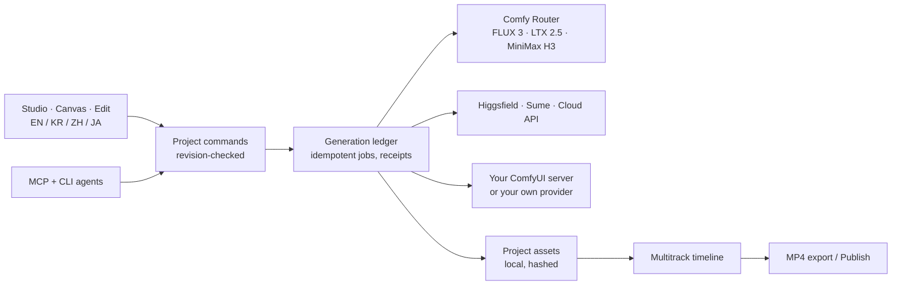

<p align="center">
  
</p>

<h3 align="center">Direct images, films, voices and edits in one project. Pick any model. Own every file.</h3>

<p align="center">
  <a href="LICENSE"></a>
  
  
  
</p>

<p align="center">
  <a href="#run-it-in-two-minutes"><b>Run it</b></a> ·
  <a href="#what-you-get"><b>What you get</b></a> ·
  <a href="#comfy-router-models"><b>Comfy models</b></a> ·
  <a href="#how-it-fits-together"><b>Architecture</b></a> ·
  <a href="#extend-it"><b>Extend it</b></a>
</p>

---

Higgsfield promised to open-source its platform. **Viral Hit is our open answer**: a creative studio you run yourself, where image, video, audio, editing and an agent harness share one project. Results land as real files in your project, go straight onto a multitrack timeline, and export as MP4. No lock-in to one model vendor: connect Comfy Router, Higgsfield, Sume, your own ComfyUI server, or a model you wrote yourself.

<p align="center">
  
</p>

## What you get

<table>
  <tr>
    <td width="50%"></td>
    <td width="50%"></td>
  </tr>
  <tr>
    <td><b>Studio.</b> Nine creation tools: image, video, remix (motion transfer, subject swap, restyle), lip sync, voice, music, captions and dubbing, enhance and analysis. Choose the task, then any provider and model that supports it.</td>
    <td><b>Canvas.</b> Lay out ideas, prompts and generations on an infinite board, branch versions, and send the winners to the edit.</td>
  </tr>
  <tr>
    <td></td>
    <td></td>
  </tr>
  <tr>
    <td><b>Edit.</b> A real multitrack timeline: visuals, overlays, audio and captions, reversible takes, recovered drafts and MP4 export in the browser or on the server.</td>
    <td><b>Connections.</b> Paste a key once. Keys stay encrypted on your server, are never sent to the browser, and each job remembers the key it started with.</td>
  </tr>
</table>

| Higgsfield-style app | In Viral Hit |
|---|---|
| Image and video generation | **Studio → Image / Video** with any connected provider |
| Cinema Studio (direct the shot) | [Shot controls](docs/SHOT-CONTROLS.md) for framing, lens, camera move, light and look, plus [storyboards](docs/STORYBOARDS.md) that plan, produce and accept each shot |
| Genjutsu / Openjutsu (swap a character in a video) | **Studio → Remix** with motion transfer, subject swap and restyle |
| Consistent characters | [Characters](docs/CHARACTERS.md): reference images and written rules reused in every project |
| Lip sync, voice, music | **Studio → Lip sync / Voice / Music** |
| Publishing | [Publish](docs/PUBLISHING.md) to YouTube, Instagram or your own installed destination, with [performance readings](docs/MEASUREMENT.md) |
| Agents | Every action is also an [MCP tool and CLI command](docs/ARCHITECTURE.md), so an AI agent can run the studio too |

The interface ships in **English and Korean** (switch with EN / KR in the header), plus Chinese and Japanese.

<p align="center">
  
</p>

## Comfy Router models

The [Comfy provider](extensions/comfy-router/README.md) puts Comfy Router models straight into Studio. One `COMFY_API_KEY` covers all of them.

| Model | Router ID | Studio task | Inputs |
|---|---|---|---|
| **FLUX 3 Image** | `bfl/flux-3-image` | Create image, Edit image | Prompt, up to 10 reference images, 768sq to 4K |
| **FLUX 3 Video** | `bfl/flux-3-video` | Create video | Text-to-video or keyframes (up to 10 images), 5–20 s, HD to 4K, audio |
| **LTX 2.5 Pro / Fast** | `ltx/ltx-2-5-pro`, `ltx/ltx-2-5-fast` | Create video | 16:9 or 9:16, 720p to 2160p, 24–50 fps, audio |
| **MiniMax H3** | `minimax/minimax-h3` | Create video | Text, first and last frame, 768P or 2K, 4–15 s |

Generations go through Comfy's request queue with a fixed idempotency key, so a lost response is collected again instead of paid for twice. Results are downloaded into your project right away, because Router links expire within hours.

## Run it in two minutes

Requires Node 24+, pnpm 10 and FFmpeg.

```sh
git clone https://github.com/slit-company/viral-hit.git
cd viral-hit
pnpm run setup

# Add the Comfy models to Studio
pnpm --dir extensions/comfy-router install && pnpm --dir extensions/comfy-router build
export VIRAL_HIT_PROVIDERS_DIR="$PWD/extensions/comfy-router/dist/providers"

pnpm dev
```

Open http://127.0.0.1:3808, then **Extensions → Connect creative APIs → Comfy**, paste your Comfy API key and press **Check connection**. Studio now lists FLUX 3, LTX 2.5 and MiniMax H3. Importing media, editing and MP4 export work without any key.

To use several providers at once, copy each `dist/providers/<name>` folder into one directory and point `VIRAL_HIT_PROVIDERS_DIR` at it. The same folders also install from **Extensions → Manage runtime packages**.

## How it fits together



- **Durable jobs.** Each paid request is recorded before it is sent. After a crash the worker collects the original job instead of submitting it again.
- **Local media.** Originals stay on your machine. A reference is sent to a provider only when you start a generation that uses it.
- **Replaceable parts.** Providers, adapters, recipes, skills and publishing destinations are installed folders. Nothing model-specific is wired into the core.
- **Light by default.** No model weights or GPU are needed to run the studio; heavy engines are optional, separately installed runtimes.

## Extend it

Viral Hit is a general creative workspace with room for very specific workflows. The core stays general; anything tied to one format, brand, service or model lives in a layer you can add, fork or remove without changing the app.

| Layer | What it is | General examples | Situation-specific examples | Add your own |
|---|---|---|---|---|
| Core | Projects, assets, Canvas, timeline, durable harness, publishing, project files | Editing, export, MCP/CLI control | — | Pull request |
| Packs | General or specialized setups: recipe-only JSON or recipes + skills + character images together | Editing basics, general creative toolkit | A brand host with its shot-planning skill and editing recipes | **Packs** for combined files or public HTTPS/GitHub links ([guide](docs/CREATIVE-PACKS.md)); recipe-only files/links in Runs ([guide](docs/PACKS.md)) |
| Recipes | Versioned JSON workflows with typed forms, shared by UI and MCP | Open frame, Spoken line, Local diffusion on your ComfyUI | YouTube reference, Editable scene, Animated image story | Recipe library, `recipe import-comfy`, or a JSON file |
| Adapters | Independently installed execution engines | Audio gain, procedural tone | Your own model server or render farm | `VIRAL_HIT_ADAPTERS_DIR` ([guide](docs/EXTERNAL-ADAPTERS.md)) |
| Extensions | Optional runtimes with their own dependencies | Local media composition | ima2 images, YouTube intake | `extensions/<name>/` |
| Skills | Know-how an AI agent follows through MCP, labeled general or specialized | Recipe packs, Consistent characters | Product ad shots (example) | The Skills page: import, review updates and remove installed skills; or use `VIRAL_HIT_SKILLS_DIR` ([guide](docs/SKILLS.md)) |
| Publishing connectors | Installed destinations with their own media types, metadata form and delivery code | Local release archive (example) | Your own channel, DAM or review service | `VIRAL_HIT_PUBLISHING_CONNECTORS_DIR` ([guide](docs/PUBLISHING.md#install-a-publishing-connector)) |
| Providers | Image and video models behind the Canvas, Studio and MCP generation | Cloud API (any compatible endpoint), Procedural images (example) | Your own model server, a brand-tuned model, an API Viral Hit does not ship | A folder in `VIRAL_HIT_PROVIDERS_DIR` ([guide](apps/studio/docs/PROVIDERS.md#install-a-provider-without-changing-the-app)) |

A workflow for one campaign or brand belongs in its own recipes and adapters, kept in a separate repository if it carries private rules or data. [CONTRIBUTING.md](CONTRIBUTING.md) explains where each kind of contribution goes and how to propose a pack. Project files move editable work between installations, so specialized setups can share results with general ones.

**Extensions** shows installed model providers, workflow adapters, publishing connectors and skills, including missing settings and load failures. [The same diagnostics](docs/EXTENSION-STATUS.md) are available through MCP and CLI. Checking metadata never starts generation or publishing; loaded metadata does not mean execution has been tested.

[Runtime packages](docs/RUNTIME-PACKAGES.md) carry complete provider, adapter and publishing modules for either general or specialized use. **Extensions → Manage runtime packages**, CLI/MCP/API support reviewed installation, replacement, removal and historical restoration. The library separates installed versions from the code currently loaded. Executable package installation requires trusted source and coordinated process restart.

Install a versioned JSON recipe to add a workflow and its typed form without modifying the studio. UI and MCP discover the same recipes. [Extension guide](docs/EXTENDING.md) covers recipe authoring, output bindings, adapter contracts and current limits. Specialized recipes and general creative projects share the same core.

Native, self-hosted ComfyUI graphs are also supported through `comfy.workflow`: see [setup, recipes and recovery semantics](docs/LOCAL-COMFYUI.md). Import your own API-format graph in **Runs → Recipe library → Import ComfyUI workflow** or with `recipe import-comfy`; the [import guide](docs/EXTENDING.md#import-your-own-comfyui-graph) includes input/output mapping and an offline example. **Runs → Connections** saves and checks your native server address without editing code or restarting the worker; managed environment overrides remain read-only. Project image parameters add a previewable selection and durable transfer to your configured ComfyUI server; try **Resize a project image** in Runs. **Check server** inspects installed native nodes and current input/model choices without submitting work; the same check is available in CLI and MCP.

The interface now uses [SEED components and a light theme](docs/DESIGN.md), with an original [Viral Hit mark and wordmark](docs/BRAND.md). For local query debugging only, set `VITE_QUERY_DEVTOOLS=true`; the debug launcher is hidden by default.

Describe framing, angle, lens, camera move, light and look with [shot controls](docs/SHOT-CONTROLS.md), written as one editable line of the prompt.

Keep a person, mascot or product consistent with [characters](docs/CHARACTERS.md): reference images plus written rules, added to any project as reference assets and a prompt brief, or chosen in the Canvas composer to attach the main image to a draft. A character file carries one to another installation. UI, MCP and CLI share the same library.

Move an editable project between installations with a [project file](docs/PROJECT-FILES.md): original media, Canvas, timelines and latest storyboard plans in one verified tar that always imports as a new project. UI, MCP and CLI share the same operations.

Unsaved timeline edits are backed up in the current browser. **Drafts** reviews and restores interrupted edits while preserving concurrent saved changes; see [editing recovery and storage limits](docs/EDITING-RECOVERY.md).

Install a new execution engine without editing the app: [external adapters](docs/EXTERNAL-ADAPTERS.md) share typed input discovery, pinned jobs, binary output receipts and editor integration. A standalone procedural WAV example is included; enable trusted modules through an operator-configured directory or a reviewed runtime package.

Optional [ima2 image recipes](extensions/ima2/README.md) connect a separately configured ima2 server for prompt-based and reference-guided image generation. Results enter the same project Assets and timeline. The bridge uses explicit provider/model selection and read-only recovery of interrupted requests; real provider quality validation remains pending.

Optional [local media recipes](extensions/local-media/README.md) compose project images, footage, music and narration into real videos. Fork a recipe to expose different controls or change the layout; generated assets can feed later composition steps without copying host paths.

Optional [REA inspection recipes](extensions/rea/README.md) analyze registered JavaScript/Electron artifacts and browser targets. Runs retain evidence summaries, static candidates and coverage limits; a companion skill turns those findings into a feature map and reconstruction plan. REA is installed separately.

Built-in [editable sequences](docs/EDITABLE-SEQUENCES.md) let any workflow prepare separate visual, overlay, music, voice and caption clips. Accept the edit after your current timeline, then change each part independently. The included image-story and narrated-scene manifests are forkable examples of the same contract.

Bring source videos into a project with [reference intake](docs/REFERENCE-INTAKE.md). Runs includes portable YouTube collection and project-video sampling recipes, with five frame previews and timeline attachment. CLI also accepts explicit Instagram direct-video items. Independent adapters can consume the resulting project video; automatic Instagram inbox collection remains pending.

[Split a video at visual cuts](docs/SCENE-DETECTION.md) scans an owned source locally, previews detected ranges and prepares separately editable clips with original audio. Its portable recipe exposes sensitivity, minimum spacing and scene count for different use cases. Visual change detection does not provide semantic video analysis.

[Optional local speech recognition](extensions/whisper/README.md) connects an operator-installed Whisper engine to source playback, SRT download and editable caption sequences. Video and audio-with-cover recipes can be forked for general or specialized work. Independent engines can emit the same [transcript contract](docs/TRANSCRIPTS.md); the default studio installs no speech model.

Use [storyboards](docs/STORYBOARDS.md) to keep a general or specialized shot plan, reference observations and accepted results together. The browser workspace and MCP/CLI/API can generate selected shots through independently authored recipes, resume pinned attempts, and assemble accepted media into an editable sequence. The bundled Storyboard director skill guides the workflow; automatic visual analysis and model-quality evaluation remain pending.


Manage optional YouTube and Instagram connections from the workspace header or `/connections`. Operator-configured Google and Meta login keep credentials encrypted on the server; Instagram requires an explicit Page-linked account selection. Connecting does not publish. Each project now has a Publish screen for retained-video review, explicit revision-bound approval and delivery status, backed by a separate resumable upload worker. YouTube and Instagram Reels/video Stories share this flow. Instagram supports local scheduling; images/carousels and live-provider verification remain pending. See [publishing setup and status](docs/PUBLISHING.md).

Share recipes, skills and character reference images together through **Packs**. [Creative packs](docs/CREATIVE-PACKS.md) support both general toolkits and specialized setups, with reviewed installation and portable files.

Discover independently authored skills and packs through [Community catalogs](docs/COMMUNITY.md). General and specialized entries use the same reviewed, checksum-pinned handoff; creators host their own JSON lists.

[Video overlays](docs/VIDEO-OVERLAYS.md) add moving, editable layers with source-range trimming, keyframes and audio volume. Import an image or video through Overlay, or fork the general `picture-in-picture` recipe for tutorials, commentary and other compositions. Browser and server exports use the same timeline contract.


## Project status

Viral Hit is in active development. Source tests, browser tests and the provider contract tests run locally and in CI. Paid generation through each provider is checked by whoever runs it with their own key; this repository does not claim model quality or speed equal to Higgsfield. The [validation ledger](docs/VALIDATION.md) and [parity targets](docs/PARITY.md) record exactly what has been run.

## Contributing and license

Read [CONTRIBUTING.md](CONTRIBUTING.md) for where each kind of change belongs. Viral Hit is released under the [Apache-2.0 license](LICENSE). Third-party components keep their own licenses, listed in [THIRD_PARTY_NOTICES.md](THIRD_PARTY_NOTICES.md).
